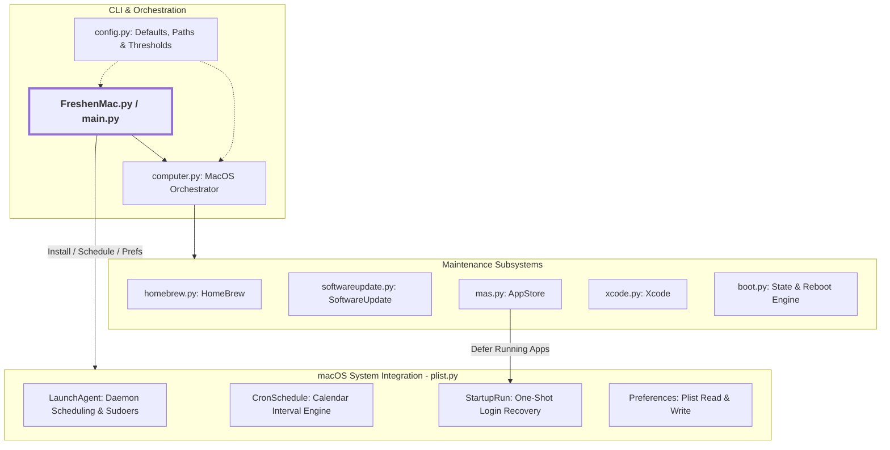

# FreshenMac

A friendly tool that automatically keeps macOS, Homebrew, and App Store apps updated.

[](https://apple.com/macos)
[](https://www.python.org/)
[](LICENSE)
[](#running-tests)

---

## Why I Built This

Every time my child came home from college, their laptop was in the same state: **zero updates installed**.

Even after I downloaded pending updates, they never restarted their computer to finish the install. Critical security
fixes and app updates sat there for months.

I built **FreshenMac** to keep their Mac updated and secure while they are away at school. It runs quietly in the
background on a schedule. It coordinates updates for Homebrew, the App Store, and macOS. It keeps your administrator
permissions active without nagging you for passwords. It waits to update open apps so it never interrupts your work.
When the Mac is truly idle, it politely restarts the computer.

---

## What It Does

- **Homebrew:** Updates tools and apps, and removes old files. Automatically detects and heals interrupted git rebases
  or dirty tap repositories. Checks and updates formula dependencies before attempting upgrades, short-circuiting build
  attempts if a dependency fails. For long error outputs, truncates verbose build logs cleanly (keeping the first 3 and
  last 3 lines). Some packages on Intel Macs need to build from source code using CMake; FreshenMac checks for Xcode
  build tools first and updates those packages individually so nothing gets blocked.
- **App Store:** Updates your Mac App Store apps using `mas`. If an app is open, FreshenMac waits to update it so you do
  not lose any work. It cleanly schedules an update for that app the next time you log in, without triggering an
  unnecessary system reboot prompt. You can also ignore apps by name or ID number.
- **Apple & macOS Updates:** Stages and downloads Apple system and software updates (including macOS, Safari, and
  security patches) in the background. Verifies staged payloads on disk against Apple's update index to avoid
  false-positive reboot prompts. If an Apple Silicon Mac needs Volume Owner authentication, FreshenMac shows a friendly
  pop-up dialog and opens the right System Settings screen for you.
- **Xcode Tools:** Automatically accepts the Xcode license. It also sets up Xcode components quietly so you do not see
  pop-up boxes after a restart.
- **Polite Restarts:** Never surprises you with a restart. It gives you a pop-up dialog where you can restart now or
  snooze. If snoozed, it waits until nobody has used the Mac for at least 60 minutes. It also pauses Time Machine
  backups safely before rebooting.
- **FileVault Fast Restart:** Uses `fdesetup authrestart` to restart past FileVault encryption straight to your desktop.
  You do not get stuck waiting at the pre-boot password screen.
- **Scheduled Background Runs:** Sets up a standard macOS background task (`LaunchAgent`). By default, it runs every
  Sunday at 2:00 AM, or on any schedule you choose.

---

## Quick Start

### Quick Install with Homebrew

The recommended way to install and manage FreshenMac is via [Homebrew](https://brew.sh) using the official tap:

```bash
brew install --cask panther37/tap/freshenmac
```

To update FreshenMac to the latest version manually at any time:

```bash
brew upgrade --cask freshenmac
```

*(Note: FreshenMac also automatically checks for and updates itself as Step 0 of every scheduled or manual run.)*

### Prerequisites

> [!NOTE]
> If you have Homebrew installed, the only prerequisite is **macOS 12.0 (Monterey) or newer**. The remaining
> prerequisites below are only necessary if you are installing or running FreshenMac manually from source.

- **macOS:** Version 12.0 (Monterey) or newer. Works on Apple Silicon and Intel Macs.
- **Python:** Version 3.9 or higher (works with macOS system Python 3.9.6+; tested through Python 3.15).
    - Download it from [python.org](https://www.python.org/downloads/) or install it with Homebrew.
    - macOS includes Python 3.9.6 when you install the Xcode Command Line Tools (`xcode-select --install`).
    - *Note: Running the automated unit test suite requires **Python 3.10+**.*
- **Xcode Command Line Tools:** (optional)
    - FreshenMac checks if you have these tools. If they are missing, it asks to install them or installs them for you.
- **Homebrew:** (optional) [`brew.sh`](https://brew.sh)
    - To install Homebrew, run this command in your Terminal:
      ```bash
      /bin/bash -c "$(curl -fsSL https://raw.githubusercontent.com/Homebrew/install/HEAD/install.sh)"
      ```
    - When tapping third-party repositories, Homebrew may ask to confirm trust (`[y/N]`). Type `y` to confirm, or grant trust manually using `brew trust panther37/tap`.
- **App Store CLI:** (optional) [`mas`](https://github.com/mas-cli/mas)
    - If Homebrew is on your Mac, FreshenMac installs `mas` for you automatically.

### Running Manually

To trigger an update run manually from your Terminal:

```bash
# If installed with Homebrew:
freshenmac

# Or if running directly from a cloned git repository:
python3 src/FreshenMac.py
```

---

## Command Options

| Flag                      | Short    | Description                                                                                                                                                        |
|:------------------------|:---------|:-------------------------------------------------------------------------------------------------------------------------------------------------------------------|
| `--verbose`               | `-v`     | Show more detail (`-v`, `-vv`, etc.). Also limits output to 10,000 characters unless you set `--debug-limit`.                                                      |
| `--debug-limit <N>`       | `-l <N>` | Set a custom character limit for logs (use a negative number for unlimited).                                                                                       |
| `--trace`                 |          | Maximum detail with no character limit. Same as `--debug-limit=-1 -vvvv`.                                                                                          |
| `--reboot <OPTION>`       | `-r`     | Reboot mode: `force`, `yes`, `skip`, `no`, or `default` (case-insensitive). Overrides reboot requirements.                                                         |
| `--action <VERB>`         | `-a`     | Run management action (`Install` or `Uninstall`; case-insensitive).                                                                                                |
| `--ignore-mas <APP...>` | `-i`     | Skip App Store apps by name or ID number (for example: `-i iPhoto 408981381`). This is not persistent. See `--save-pref`.                                          |
| `--schedule [CRON]`       | `--cron` | Set or update the LaunchAgent schedule using cron syntax (e.g. `--schedule "0 18 * * 1"` or `--schedule default`). Run without arguments to view schedule options. |
| `--save-pref [PREF]`    | `-s`     | Save a setting permanently to your preferences file (`Key=Value`). Run `-s` alone to view all settings and help.                                                   |
| `--standalone`            | `-z`     | Run once without installing anything or setting up a schedule.                                                                      |
| `--dry-run`               |          | Simulate execution without modifying system files or running privileged updates.                                                                                   |
| `--spinner`               |          | Test the terminal wave spinner animation.                                                                                                                          |
| `--version`               |          | Show the program name and version number and exit.                                                                                                                 |

### Preference Options (`--save-pref`)

These settings can be saved permanently using `--save-pref Key=Value`:

| Preference Key    | Value / Format | Description                                                                                                                   |
|:------------------|:---------------|:------------------------------------------------------------------------------------------------------------------------------|
| `download-speed`  | `<MBPS>`       | Minimum download speed in Mbps (default: 5.0) used for dynamic App Store timeouts (includes a 25% safety buffer).              |
| `no-mas`          | `<APP...>`     | Space-separated list of App Store app names or IDs to permanently skip (e.g. `no-mas="iPhoto 408981381"`).                   |
| `schedule`        | `<CRON>`       | LaunchAgent schedule in standard 5-field cron syntax (e.g. `schedule="0 6 * * 1"`). Also configurable via `--schedule`.       |

---

## Scheduling & Automation

FreshenMac can run quietly on its own using standard 5-field cron syntax:

```bash
# Run on the default schedule (Sunday at 2:00 AM)
freshenmac --schedule default

# Run every Monday at 6:00 PM
freshenmac --schedule "0 18 * * 1"

# Run Monday through Friday at 2:30 AM
freshenmac --schedule "30 2 * * 1-5"

# Run on the 1st and 15th of every month at midnight
freshenmac --schedule "0 0 1,15 * *"

# View schedule options and syntax help
freshenmac --schedule
```

This configures a system-wide background service and unattended maintenance configuration:

- **Command-Line Tool:** Installs the `freshenmac` command directly into your Homebrew path (`/opt/homebrew/bin/freshenmac` on Apple Silicon or `/usr/local/bin/freshenmac` on Intel).
- **Background Maintenance Service (`LaunchAgent`):** Automatically installs and activates `/Library/LaunchAgents/com.panther37.FreshenMac.plist` to run unattended maintenance every Sunday at 2:00 AM (or on your custom schedule).
- **Unattended Sudo Privileges:** Sets up `/etc/sudoers.d/freshenmac` so scheduled background runs can perform system and software updates without prompting for passwords.

To install or remove the scheduled service:

```bash
# Install the background service and sync script files
freshenmac --action install

# Remove and delete the scheduled background service
freshenmac --action uninstall
```

### Saving Preferences

You can save your settings so FreshenMac remembers them every time it runs. Settings are stored system-wide in
`/Library/Preferences/com.panther37.FreshenMac.plist`:

```bash
# View all settings and their current values
freshenmac --save-pref

# Set a persistent schedule using cron syntax
freshenmac --save-pref "schedule=0 18 * * 1"

# Set minimum expected download speed for dynamic App Store timeouts (in Mbps)
freshenmac --save-pref download-speed=10

# Skip an App Store app by name (for example, old software like iPhoto)
freshenmac --save-pref "no-mas=iPhoto"

# Skip an App Store app by its numeric ID number
freshenmac --save-pref no-mas=408981381

# Skip multiple apps at once (separate names or IDs with a space)
freshenmac --save-pref "no-mas=Aperture 408981381"
```

---

## How Rebooting Works

FreshenMac keeps your Mac secure without getting in your way:

1. **Checks Uptime and Requirements:** It only suggests a restart if your Mac has been turned on for more than 15 days,
   or if an installed or staged Apple update requires a reboot.
2. **Asks Before Restarting:** If someone is using the Mac, a pop-up box asks you to **Restart Now** or **Snooze**.
3. **Waits for Idle Time:** If you click Snooze, FreshenMac waits until nobody is using the keyboard, mouse, or
   terminal. Once the computer has been quiet for 60 minutes, it safely restarts.
4. **Protects Backups:** If Time Machine is backing up files, FreshenMac asks it to pause safely before restarting.
5. **Fast FileVault Restart:** If FileVault disk encryption is turned on, FreshenMac uses `authrestart`. This boots
   straight back to the desktop without getting stuck at the login lock screen.
6. **Catches Up on Open Apps:** If an App Store app could not update because you were using it, FreshenMac schedules a
   one-shot update (`StartupRun`) for your next login. Once updated, the task removes itself. Deferred app updates
   never trigger an unnecessary system reboot prompt.

---

## Architecture

FreshenMac is built with small, separate pieces where each tool has one job:



### Module Breakdown

- `FreshenMac.py`: Starts the program and returns the exit code.
- `freshenmac/main.py`: Reads command-line options, handles service management actions (`Install`, `Uninstall`),
  prompts for administrator passwords when needed, and starts tasks.
- `freshenmac/computer.py`: Coordinates the update run. Checks hardware details, uptime, and idle time. Prints the final
  summary report.
- `freshenmac/homebrew.py`: Updates Homebrew tools and apps using a single-pass query (`brew outdated --json=v2`) for
  formulae and casks. Checks dependency prerequisites before builds, truncates long error outputs, handles source code
  builds on Intel Macs, and cleans up old files. Filters reboot triggers strictly to system restarts.
- `freshenmac/mas.py`: Updates Mac App Store apps using `mas`. Checks for running apps with `util.is_app_running` so it
  does not interrupt your work, deferring them via `StartupRun` without triggering false reboots.
- `freshenmac/softwareupdate.py`: Downloads and installs Apple software and macOS updates (including Safari and
  developer tools). Validates and counts staged payload directories on disk to avoid false-positive reboot requests.
  Opens System Settings if an owner password is required.
- `freshenmac/boot.py`: Defines state tracking (`ActionState`, `RebootState`) and handles computer
  restarts. Manages snooze dialogs, idle countdowns, Time Machine safety, and FileVault fast restarts.
- `freshenmac/xcode.py`: Checks for Xcode and Command Line Tools. Accepts the license agreement and finishes setup
  tasks.
- `freshenmac/plist.py`: Handles macOS system setup with the following core components:
    - `LaunchAgent`: Creates background schedule files in `/Library/LaunchAgents` and configures
      `/etc/sudoers.d/freshenmac` for unattended maintenance.
    - `StartupRun`: Creates a one-time login task to finish updating apps that were open during the main run.
    - `SavePreferences` and `load_preferences`: Reads and saves system-wide preferences in `/Library/Preferences/`.
    - `CronSchedule`: Encapsulates calendar intervals and parses 5-part cron syntax or launchd dictionaries into Cartesian intervals.
- `freshenmac/config.py`: Stores default settings, timeouts, file paths, and rules.
- `freshenmac/util.py`: Helper tools: runs shell commands (`RunCMD`), executes AppleScript (`RunAppleScript`), detects
  active applications (`is_app_running`), handles safe string joining (`str_join`), parses natural version numbers
  (`Version`), manages masked user authentication credentials (`TortimerCreds`), keeps administrator permissions active
  (`SudoKeepAlive`), and draws the progress spinner (`Wave`).

---

## Running Tests

FreshenMac has 329 automated tests (requires **Python 3.10+**; the runtime package itself supports **Python 3.9+**).
These tests verify that everything works correctly and that code follows strict project rules (like keeping classes,
methods, constants, and imports in alphabetical order):

```bash
# Run all tests
PYTHONPATH=src python3 -m unittest discover -s test
# Or using the test runner helper:
./test/run_tests.sh

# Run real CLI fixture integration tests
PYTHONPATH=src python3 -m unittest test/test_fixtures.py

# Run code style and structure checks
PYTHONPATH=src python3 -m unittest test/test_architecture.py
```

All tests are safe to run. They use mock data and recorded CLI fixtures (`test/fixtures/`) so they never restart your
real computer or change your actual system files.

### Test Fixtures

Integration tests replay real CLI outputs captured from macOS systems using `SimRunCMD`:

- `test/fixtures/brew/outdated/20261023-2233/`: Real combined output from `brew outdated --json=v2` (containing both
  formulae and casks, and verifying pinned vs unpinned packages).
- `test/fixtures/brew/repository/`: Real output from `brew --repository`.
- `test/fixtures/brew/cleanup/`: Real output from `brew cleanup --prune=all`.

Large diagnostic payloads (such as multi-megabyte package catalogs) reside in `test/large_tests/` and are excluded from
Git to keep repository clone times fast.

---

## License & Contributing

- Distributed under the [BSD 3-Clause License](LICENSE).
- See [CONTRIBUTING.md](CONTRIBUTING.md) for contributor guidelines, testing instructions, and architectural invariants.

---

## Author

Created by **Matt Logan** (<matt@panther37.com>).

